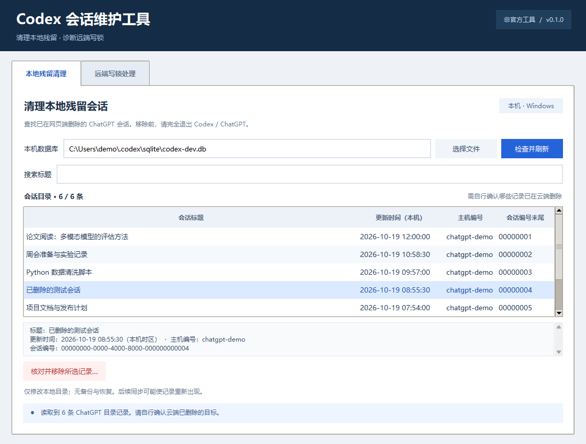
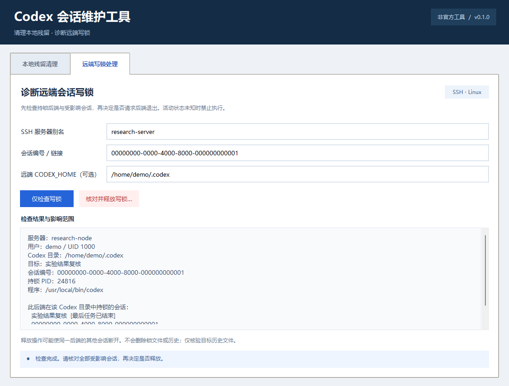

# Codex 会话维护工具

[](https://github.com/hhcmg/codex-session-tools/actions/workflows/tests.yml)

一个面向 Windows 的轻量桌面工具，集中处理 **Codex 中的 ChatGPT 残留目录记录**和 **Linux 远端 Codex 会话写锁**。提供两个页签的统一 GUI，并保留独立命令行入口。

**非官方工具，当前为 `0.1.0` 预览版。** 它依赖 Codex 的内部数据库与文件布局；结构检查通过不代表所有应用版本均已验证。没有后台服务、遥测或自动修复任务。





截图使用虚构会话和服务器，不包含真实对话数据。

## 功能与边界

| 功能 | 适用场景 | 实际操作 |
| --- | --- | --- |
| 本地残留清理 | 会话已在网页端删除，但仍显示在 Codex 侧栏 | 移除一条 ChatGPT 本地目录记录，在同一事务中更新计数器和必要的扫描标记 |
| 远端写锁处理 | Linux 远端会话被 Codex 后端持锁 | 经检查和人工确认，向唯一确认的后端发送一次 SIGTERM，再核验锁和目标历史 |

- 本地列表包含全部 ChatGPT 目录记录，**无法自动识别哪些会话已在云端删除**。
- 本地清理不会调用云端删除接口；不提供备份、撤销或恢复。后续同步可能使记录重新出现。
- 远端操作可能使同一后端持锁的其他会话断开；活动状态未知或存在未完成任务时禁止执行。
- 远端助手不会删除锁文件或历史，不会使用 SIGKILL，也不会继续终止其他进程。
- 远端历史完整性检查只针对目标会话文件的路径和 SHA-256；它不是所有会话的备份或应用状态证明。

## 快速开始

1. 下载并解压本仓库，保留目录结构。
2. 准备 **Python 3.10+，包含 Tkinter**。源代码直接运行无需安装第三方 Python 包。
3. 双击 **`打开维护工具.cmd`**。启动器自动探测 `py -3` / `python`，不依赖作者电脑的安装路径。
4. 选择所需页签。启动 GUI 不会自动读取数据库，也不会自动连接服务器。

也可以在项目目录运行：

```powershell
python -m codex_session_tools
```

若要安装为命令行程序，可在虚拟环境内运行 `python -m pip install .`，随后使用 `codex-session-tools`。安装构建阶段需要 setuptools；直接从源码运行不需要此步骤。

### 本地残留清理

1. 在网页端确认目标会话已经删除。
2. 完全退出 Codex / ChatGPT 桌面应用；只关窗口可能仍有后台进程。
3. 在 GUI 确认数据库路径，点击“检查并刷新”，按标题查找。
4. 核对完整标题、主机编号和会话编号；点击“核对并移除所选记录”。
5. 勾选确认项，输入界面要求的 `REMOVE <完整会话编号>`。
6. 完成后重新打开 Codex 检查侧栏。

默认数据库为 `$env:CODEX_HOME\sqlite\codex-dev.db`；没有设置环境变量时使用用户主目录下的 `.codex\sqlite\codex-dev.db`。可以在 GUI 或 CLI 指定其他路径。数据库缺失时不会创建新数据库。

### 远端写锁处理

准备本机 OpenSSH 客户端，以及通过密钥或 ssh-agent 登录的服务器别名。远端需要 **Linux、Python 3.9+、`/proc` 和 pidfd 支持**。

首次连接请先手动运行 `ssh my-server`，正常核实主机密钥并完成登录。本工具不会关闭主机密钥校验，也不会弹出密码登录流程。用户名、端口、代理跳转等配置放在 SSH config 中。

1. 输入 SSH 别名和会话 UUID，或 `codex://threads/<UUID>` 链接。
2. 如远端使用自定义目录，填写“远端 CODEX_HOME”。
3. 点击“仅检查写锁”，核对服务器用户、目录、持锁 PID 及受影响会话。
4. 先关闭原应用中的目标会话，避免它重新占锁。只有检查允许时才能继续。
5. 确认可断开全部受影响会话后，输入 `UNLOCK <PID>`。
6. 根据结果返回应用重试；如果结果未知，先重新“仅检查”。

## 独立命令行入口

### 本地清理 CLI

默认仅检查，不修改：

```powershell
python -m codex_session_tools cleanup --query "示例标题"
python -m codex_session_tools cleanup --db "C:\path with spaces\codex-dev.db" --json
```

移除必须同时指定主机和会话编号，随后在交互式终端确认：

```powershell
python -m codex_session_tools cleanup --host-id "实际主机编号" --thread-id "实际会话编号" --remove
```

也可调用 `Cleanup-Codex.cmd` 并附加同样参数。没有批量删除或跳过确认的选项；管道输入不能代替人工确认。

Python CLI 的标准输出和错误输出使用 UTF-8，便于在不同 Windows 语言环境下显示中文，并将结果重定向到文件或管道。

### 远端 Python CLI

```powershell
python -m codex_session_tools unlock --server my-server --thread-id "实际UUID" --inspect-only
python -m codex_session_tools unlock --server my-server --thread-id "实际UUID" --codex-home "/srv/user/codex"
```

`--json` 隐含仅检查，输出包含会话标题、编号和远端目录，分享前请脱敏。仅检查模式必须提供服务器与会话编号，不会交互索取缺失参数。

### 独立 PowerShell 入口（Windows 无需 Python）

双击 `Unlock-Codex.cmd`，或者：

```powershell
powershell.exe -NoProfile -ExecutionPolicy Bypass -File .\Unlock-Codex.ps1 -Server my-server -ThreadId "实际UUID" -InspectOnly
powershell.exe -NoProfile -ExecutionPolicy Bypass -File .\Unlock-Codex.ps1 -Server my-server -ThreadId "实际UUID" -CodexHome "/srv/user/codex"
```

该入口复用同一个远端 Python 助手，因此只需要远端安装 Python。PowerShell 的参数使用 `-Server` 等形式，与 Python CLI 的 `--server` 不同。启动命令中的 ExecutionPolicy 只影响该 PowerShell 进程，不修改机器策略。

如确需记录审计信息，可给 PowerShell 入口显式传入 `-LogPath "C:\private\maintenance.log"`。默认所有入口均不写操作日志。

### 退出码

| 退出码 | 含义 |
| --- | --- |
| 0 | 完成、无需操作、仅检查通过或用户取消 |
| 1 | 输入、环境、连接错误，或已明确拒绝执行 |
| 2 | 阻止解锁、锁仍存在或执行结果未知；参数解析错误也可能返回 2 |
| 3 | 锁已释放，但目标历史已变化或不能确认 |
| 130 | Python CLI 被用户中断；若已确认解锁，需重新仅检查 |

## 隐私与保护措施

- 本地目录、选择快照和远端诊断结果仅在内存中处理；GUI 不保存连接参数。
- 本地删除前比较数据库来源、结构、完整目录行及主机快照。所有写入在单个 SQLite 事务内完成，失败回滚。
- Windows 进程检测失败时停止操作；进程名称检测是保守检查，不能替代完全退出应用。
- SSH 使用已有配置、严格主机密钥校验，并关闭本次连接的端口转发。
- 远端检查会读取会话元数据、近期生命周期事件，并读取目标历史文件计算哈希；不将对话正文作为诊断输出返回。
- SIGTERM 前重新检查进程身份、锁、历史状态与影响范围。PID 不明、未知活动状态、结构异常等情况都拒绝执行。
- 超时、断连或返回数据损坏时可能无法判断远端动作是否完成。**不会自动重试解锁**。
- 可选日志可能含服务器别名、会话编号、PID、路径和哈希，不应提交到 GitHub。`.gitignore` 已排除日志、数据库、历史文件、环境配置和构建缓存。

## 兼容性与测试

当前没有宣称经过端到端验证的 Codex 应用版本列表。预览版通过结构检查识别可处理的数据库；应用升级后仍需重新验证。[兼容性说明](docs/compatibility.md) 解释检查范围和限制。

运行测试：

```powershell
python -m unittest discover -s tests -v
```

测试使用临时数据库、虚构会话和模拟 SSH；Linux 用例还检查临时真实文件锁，所有终止信号均模拟。没有测试会终止真实 Codex 后端。GUI 测试需要图形桌面；Linux 可使用 `xvfb-run -a python -m unittest discover -s tests -v`。

GitHub Actions 检查 Windows / Ubuntu × Python 3.10 / 3.13，包含测试、包安装和命令行入口验证。[查看最新 CI 结果](https://github.com/hhcmg/codex-session-tools/actions/workflows/tests.yml) · [验证与发布说明](docs/testing-and-release.md)

## 故障排查

| 提示或现象 | 处理方式 |
| --- | --- |
| 找不到 Python / Tkinter | 安装包含 Tkinter 的 Python 3.10+，验证 `python -m tkinter`；仅远端功能也可用独立 PowerShell 入口 |
| 找不到数据库 | 确认这是 Codex 本地目录数据库，并检查 CODEX_HOME；不要创建空数据库代替 |
| 数据库结构不受支持 | 停止修改，提交脱敏后的结构错误和应用版本；不要删除检查代码强行运行 |
| 检测到应用仍在运行 | 完全退出 Codex / ChatGPT；同名 CLI 也可能触发保守阻止 |
| SSH 认证或主机密钥失败 | 在终端正常运行 `ssh my-server` 排查，不要禁用主机密钥校验 |
| 未完成任务 / 状态未知 | 回原应用停止或等待任务，之后重新检查；预览版没有强制绕过 |
| 锁仍存在 / 结果未知 | 重新仅检查；可能由其他进程继承文件描述符或被应用重新获取 |
| 删除已完成但刷新失败 | 删除已提交，界面会清空旧列表；重新刷新即可，不要认为已回滚 |

## 项目结构

```text
codex_session_tools/
  gui.py               两个页签和确认弹窗
  cli.py               Python 命令行入口
  local_catalog.py     本地结构检查、快照与事务
  remote_client.py     SSH 传输和结果协议
  remote_helper.py     独立运行的 Linux 助手
  presentation.py      共享显示与结果解释
tests/                 合成数据库、协议、GUI、启动器和 Linux 锁测试
Unlock-Codex.ps1        无需本机 Python 的独立远端入口
```

原两个项目不需要与本仓库一起分发。本项目以 MIT 许可证发布；参见 [LICENSE](LICENSE)。贡献与安全反馈分别见 [CONTRIBUTING.md](CONTRIBUTING.md) 和 [SECURITY.md](SECURITY.md)。
